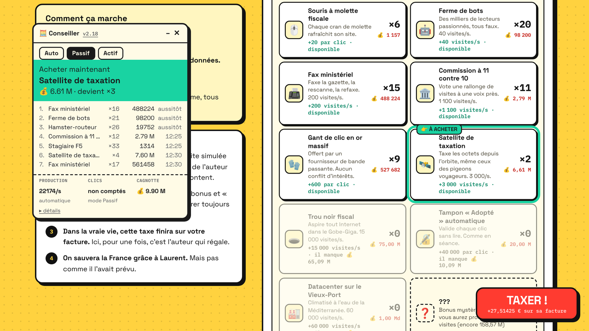
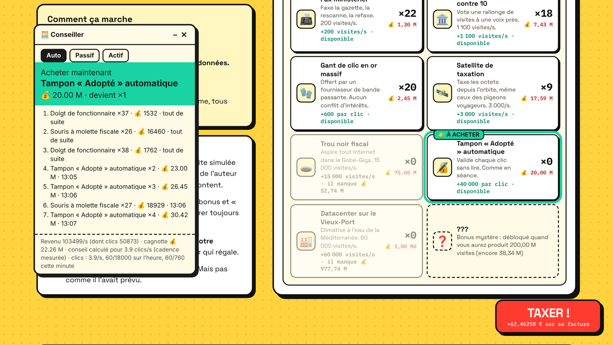
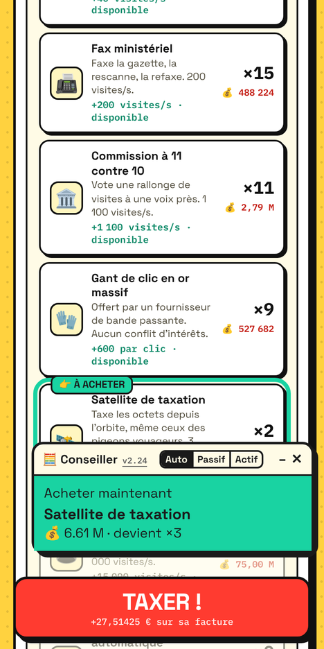

# Conseiller — Taxe au Giga

Panneau posé sur la page de [Taxe au Giga](https://taxe-au-giga.fr/) qui surligne le bonus à acheter, avec le compte à rebours jusqu'au prochain achat et les huit suivants.

Il lit ce que le jeu affiche. **Aucun clic, aucun achat, aucun appel au serveur du jeu.**

[](https://actarus314.github.io/conseiller-taxe-giga/)



| Mode Auto pendant des clics | Téléphone |
|---|---|
|  |  |

## Modes

| Mode | Cadence de clic prise en compte |
|---|---|
| **Auto** (défaut) | mesurée sur la série de clics TAXER en cours (15 dernières secondes) ; arrêt détecté après 2 à 5 s sans clic (4 intervalles habituels), conseil passif aussitôt |
| Passif | aucune : seule la production automatique compte |
| Actif | fixée à la main (5 clics/s par défaut) |

Dans tous les cas, la cadence retenue reste sous 760 clics par minute (12.7/s), et le reste du quota de 18000 clics par heure se répartit sur 15 min quand il ne suffit plus. Le compteur horaire est gardé dans le navigateur ; les clics faits avant l'ouverture du panneau ne sont pas connus.

## Installation

- **Script utilisateur** (Tampermonkey, Violentmonkey) : ouvrir [`conseiller.user.js`](https://raw.githubusercontent.com/actarus314/conseiller-taxe-giga/main/conseiller.user.js), l'extension propose l'installation. Le panneau s'ouvre à chaque visite du jeu.
- **Favori autonome** : créer un favori dont l'adresse est le contenu de [`bookmarklet.txt`](bookmarklet.txt) (ou le glisser depuis la page d'installation), puis le cliquer sur la page du jeu. Un second clic ferme le panneau.
- **Favori court**, qui charge toujours la dernière version publiée sur `main` (cache du CDN de 12 h au plus) :
  ```
  javascript:fetch('https://cdn.jsdelivr.net/gh/actarus314/conseiller-taxe-giga@main/conseiller.js').then(r=>r.text()).then(eval)
  ```

Sur téléphone, le panneau s'ouvre réduit au conseil ; le bouton « – » le déplie.

## Modèle

- Prix d'un bonus : arrondi supérieur de `base × 1.15^possédés`.
- Visites par clic : `floor(1 + Σ bonus de clic + (0.01 + Σ bonus en %) × production/s)`.
- Choix : le bonus qui minimise *attente avant de pouvoir le payer* + *temps pour qu'il se rembourse*.

Barème recopié du code du jeu (build 2026-11-03e). Une alerte rose apparaît si un prix ou la puissance de clic affichés ne correspondent plus.

## Développement

- `conseiller.js` est la seule source ; `python3 dev/outils/build.py <version>` génère `conseiller.user.js`, `bookmarklet.txt` et `index.html`.
- Tests : `cd dev/tests && npm install && npm test`.
- Simulateur des stratégies : `python3 dev/sim/modele.py <clics par seconde>`.
- Captures : `dev/outils/captures.py` (mode d'emploi en tête du fichier).
